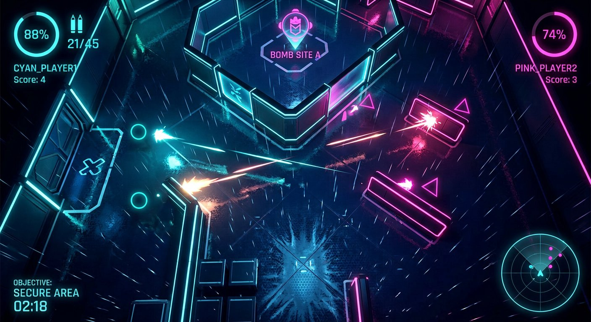
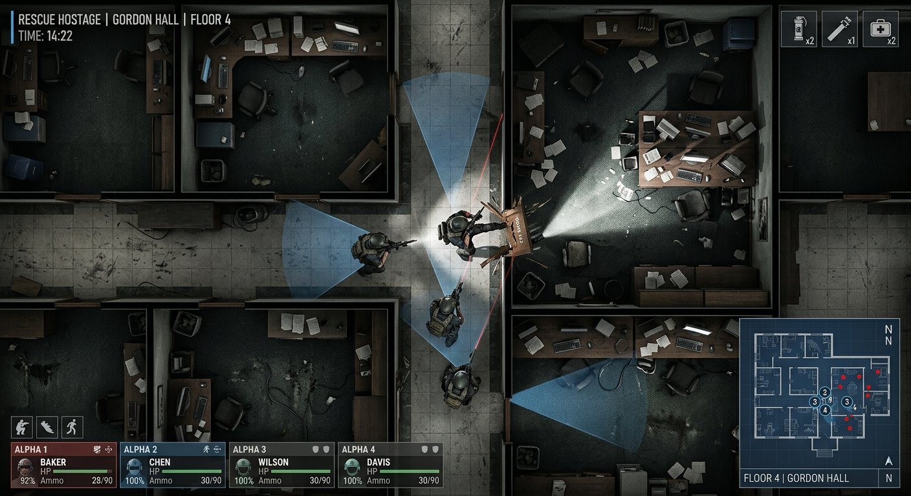
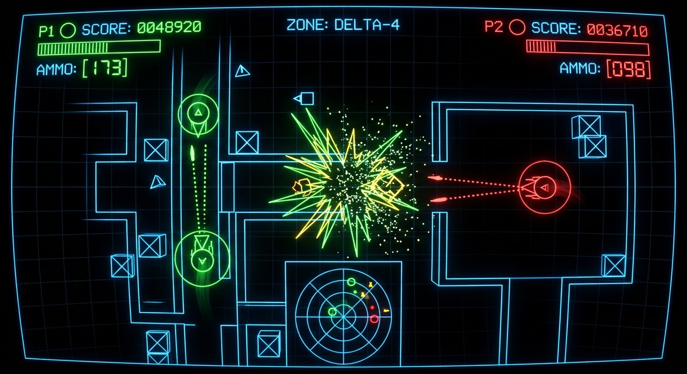
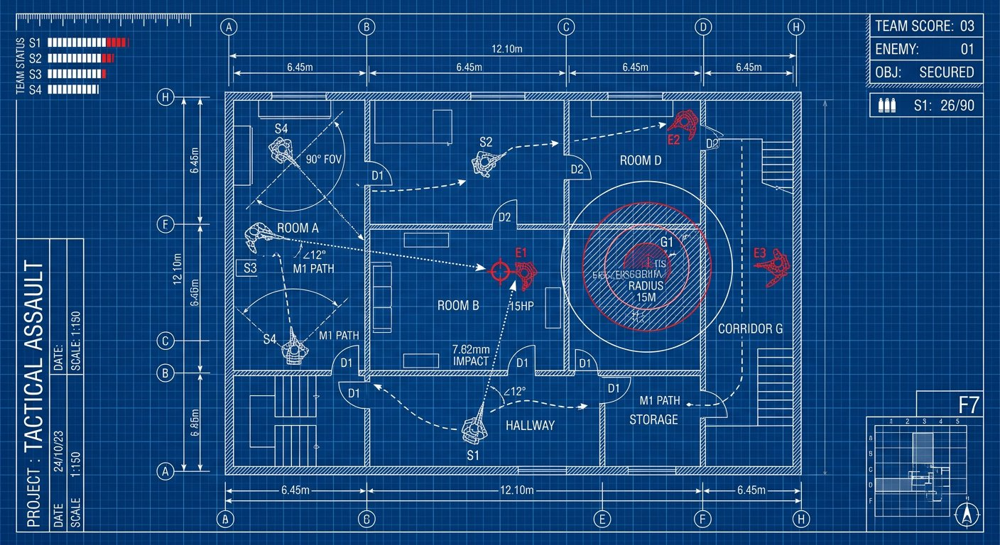
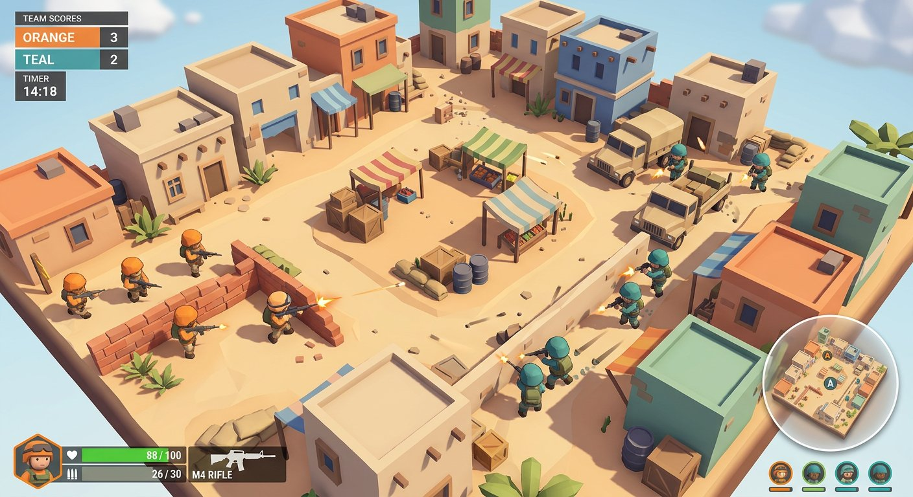
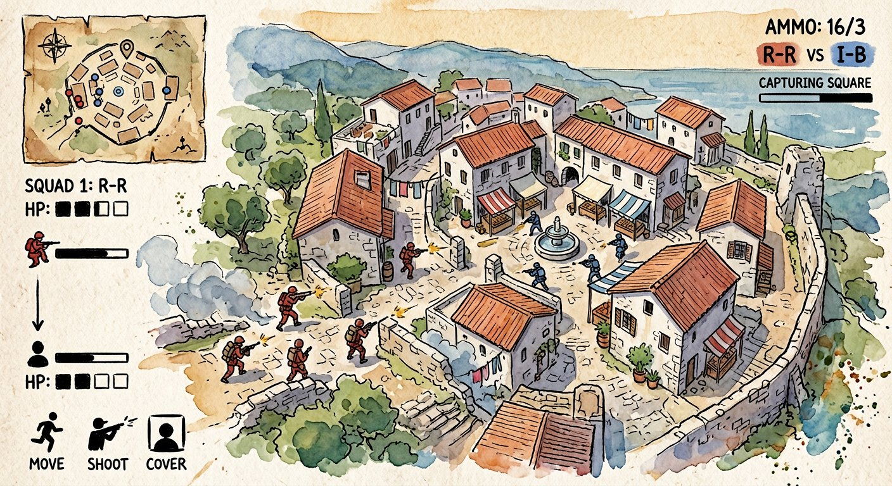

# 🎨 Концепт-арт: 9 визуальных стилей для Top-Down Tactical Shooter

> Этап 1 разработки. Один и тот же игровой сценарий (тактическая карта, две команды, перестрелка, HUD)
> показан в 9 кардинально разных визуальных стилях. После выбора стиля начнётся разработка игры
> (боты, LAN-мультиплеер, карты в духе Counter-Strike).

---

## 1. «КРОВЬ И ПИКСЕЛИ» — классический 2D пиксель-арт

> 🖼 *Визуальный концепт будет догенерирован после выбора / в следующем сообщении (лимит генераций). Стиль легко представить по Hotline Miami и GTA 2.*

1. **Общий стиль:** 16-битный пиксель-арт, строгий вид сверху (90°), крупные «жирные» пиксели, лёгкий эффект CRT-монитора и сканлайнов.
2. **Цветовая палитра:** насыщенная тёплая гамма 80-х: бирюза, маджента, грязно-жёлтый, кирпичный. Яркая, слегка «выцветшая плёнка».
3. **Персонажи:** спрайты ~24×24 px: видны голова, плечи и ствол оружия. Команды различаются цветом формы (оранжевые террористы vs синий спецназ) и силуэтом шлема/банданы. Анимация — 4 кадра ходьбы, покачивание корпуса.
4. **Карты:** тайловые полы (плитка, бетон, песок), стены с пиксельной текстурой кирпича, ящики, бочки, машины как в GTA 2. Много мелкого «мусора» для живости.
5. **Эффекты:** пиксельные вспышки выстрелов, пунктирные трассеры, лужи крови, остающиеся на полу, гильзы-пиксели, дым из полупрозрачных квадратов. Взрыв — 6-кадровый спрайт-«гриб».
6. **HUD:** пиксель-шрифт, полоса HP «ступеньками», счётчик патронов цифрами 8×8, квадратный радар с точками-пикселями в углу.
7. **Атмосфера:** драйв, адреналин, ностальгия, «грязный» неоновый криминал 80-х. Быстрый, жестокий, аркадный темп.
8. **Референсы:** Hotline Miami, GTA 1/2, Intravenous, The Hong Kong Massacre.
9. **Сложность реализации:** **Средне (ближе к легко).** Спрайты маленькие и рисуются быстро, анимаций мало; нужен аккуратный пиксель-арт, но объём ассетов небольшой.
10. **Геймплейный характер:** поощряет быстрый агрессивный ближний бой и раунды по 30–60 секунд.

---

## 2. «DUSTLINE ISO» — изометрия с детализированными спрайтами

> 🖼 *Визуальный концепт будет догенерирован после выбора / в следующем сообщении (лимит генераций). Ориентир: Commandos, Desperados, ранний Fallout Tactics.*

1. **Общий стиль:** изометрическая камера 45°, богато детализированные рисованные 2D-спрайты, мягкие тени, «миниатюрный» вид поля боя.
2. **Цветовая палитра:** тёплая живописная: песок, терракота, выгоревшая зелень, пыльная дымка. Яркое солнце, длинные тени.
3. **Персонажи:** фигурки в 3/4 ростом ~48 px, видны лицо, разгрузка, оружие. 8 направлений анимации. Команды: песочный камуфляж vs тёмно-синяя форма спецназа; различимы классы (штурмовик, снайпер с длинным стволом).
4. **Карты:** здания с объёмом и крышами, рынки с навесами, мешки с песком, пальмы. Изометрия даёт «высоту»: укрытия, балконы, крыши. Сотни мелких пропсов.
5. **Эффекты:** мягкие клубы пыли от попаданий, веерные вспышки, дымовые завесы полупрозрачными спрайтами, отбрасываемые тени от взрывов.
6. **HUD:** элегантный минимализм по краям экрана, изометрическая миникарта-«диорама», портреты отряда.
7. **Атмосфера:** «настольная стратегия оживает»: тактическая глубина, неспешная вдумчивость, красота диорамы.
8. **Референсы:** Commandos 2, Desperados III, Shadow Tactics, Door Kickers 2 (карты), Jagged Alliance 2.
9. **Сложность реализации:** **Сложно.** 8 направлений × анимации × классы, сортировка по глубине, окклюзия крыш, огромный объём спрайтов. Самый «художественно дорогой» вариант.
10. **Геймплейный характер:** позиционная тактика, важность углов и высоты; темп средний.

---

## 3. «NEON PROTOCOL» — минималистичный неон / киберпанк

1. **Общий стиль:** строгий топ-даун, почти чёрный тёмно-синий «пол» высокотехнологичного комплекса, всё очерчено светящимся неоном, сильный bloom.
2. **Цветовая палитра:** глубокий чёрный и индиго + два неоновых акцента: циан vs маджента. Тёмная, контрастная, «ночной город после дождя».
3. **Персонажи:** гладкие тёмные силуэты сверху с неоновой окантовкой цвета команды и светящимся «визором»; направление взгляда читается по полосе света. Минимализм = мгновенная читаемость «свой/чужой».
4. **Карты:** полированные полы с отражениями и сеткой, стены-трим с подсветкой по кромке, голографические маркеры плента (BOMB SITE A светится сквозь стены).
5. **Эффекты:** яркие светящиеся трассеры, освещающие пол; вспышки-искры, неоновые «брызги» при попадании (стилизованно, без натурализма), ударная волна-кольцо у взрыва, дождь из светящихся капель.
6. **HUD:** голографический: кольцо здоровья %, угловатые цифры патронов, круглый неоновый радар, тонкий шрифт с свечением.
7. **Атмосфера:** стильный ночной драйв, синтвейв, «Tron встретил Counter-Strike». Холодная, технологичная эйфория.
8. **Референсы:** Geometry Wars (свечение), Neon Chrome, RUINER (палитра), Hyper Light Drifter (минимализм).
9. **Сложность реализации:** **Легко.** Фигуры и линии + пост-эффекты свечения на Canvas/WebGL; спрайтов почти не нужно, весь бюджет уходит в «сок» (glow, частицы, тряска камеры).
10. **Геймплейный характер:** быстрый, аркадный, отлично читаемый; идеален для динамичных раундов и эффектных клатчей.

---

## 4. «SILENT ENTRY» — реалистичный военный тактический

1. **Общий стиль:** фотореалистичные текстуры строго сверху, «план этажа в реальной жизни». Никакой стилизации — серьёзный милитари.
2. **Цветовая палитра:** приглушённая, десатурированная: серый бетон, оливковый, тёмное дерево, холодный свет фонарей. Мрачно и документально.
3. **Персонажи:** операторы SWAT сверху: шлем, плитник, подсумки, винтовка с ЛЦУ и фонарём; конус света и тонкая красная линия лазера. Команды: тёмный спецназ vs пёстрые «боевики» в гражданской одежде и банданах.
4. **Карты:** офисы со столами и бумагами, склады, квартиры: ковры, плитка, двери, мебель — всё как настоящее. Динамический свет, конусы обзора, тьма за углами.
5. **Эффекты:** реалистичные вспышки и дымка выстрелов, пыль из стен, разлетающиеся бумаги, кровь — сдержанно и жёстко, вспышка светошумовой гранаты «выжигает» экран.
6. **HUD:** профессиональный тактический: плашки отряда с HP и боезапасом, стойки (стоя/пригнувшись), миникарта — реальный план этажа, инвентарь гранат и аптечек.
7. **Атмосфера:** напряжение спецоперации, цена ошибки, «один выстрел — один труп». Медленный, параноидальный темп.
8. **Референсы:** Door Kickers 1/2, Ready or Not (вайб), Breach & Clear, Police Stories.
9. **Сложность реализации:** **Сложно.** Нужны качественные топ-даун спрайты и текстуры, динамическое освещение и конусы зрения; без художника реализм быстро «рассыпается». Делается через сгенерированные/подобранные ассеты + сильную работу со светом.
10. **Геймплейный характер:** медленный методичный штурм, проверки углов, флешки и бричинг — максимум «настоящего» тактического CS.

---

## 5. «BANG! POW! STRIKE» — мультяшный / комиксовый

> 🖼 *Визуальный концепт будет догенерирован после выбора / в следующем сообщении (лимит генераций). Ориентир: Brawl Stars сверху + комиксы Marvel.*

1. **Общий стиль:** жирные чёрные контуры, плоские яркие заливки (cel-shading), лёгкий «tilt» персонажей для обаяния, растр-«пол-тона» в тенях.
2. **Цветовая палитра:** максимально насыщенная комиксовая: алый vs кобальтовый, жёлтые акценты взрывов, конфетная яркость.
3. **Персонажи:** чиби-пропорции: большая голова в каске, коренастое тело, огромная пушка. Команды — красные «злодеи» с усами/банданами vs синие «герои» в шлемах с визорами. Эмоции и позы преувеличены.
4. **Карты:** «игрушечный» склад: толстенные ящики, красные бочки с черепом, полосатые hazard-зоны, резиновые конусы. Всё круглое и дружелюбное.
5. **Эффекты:** звёздочки-вспышки, надписи BANG!/POW!/BOOM!, пухлые облачка дыма, звёздочки над «вырубленным» вместо крови — полное отсутствие жестокости.
6. **HUD:** «пузырчатые» плашки, сердечки здоровья, толстые цифры патронов, круглая весёлая миникарта.
7. **Атмосфера:** смех, фан, «мультики субботним утром». Игра для друзей и стримов, ноль стресса.
8. **Референсы:** Brawl Stars, Worms, Advance Wars (вайб), Plants vs Zombies (дружелюбие).
9. **Сложность реализации:** **Средне.** Векторные фигурки с обводкой отлично рисуются кодом; нужен squash-and-stretch и много «сочных» анимаций, но ассетов немного.
10. **Геймплейный характер:** быстрый весёлый замес, респауны, пауэр-апы — CS превращается в вечериночный шутер.

---

## 6. «VECTOR ZONE DELTA-4» — ретро-векторный аркадный

1. **Общий стиль:** чистая светящаяся векторная графика на чёрном, как мониторы Atari 80-х; лёгкая выпуклость «экрана», фосфорное послесвечение.
2. **Цветовая палитра:** чёрный + неоновые линии: циан (карта), зелёный (P1), красный (P2), жёлтый (взрывы). Ничего лишнего.
3. **Персонажи:** геометрические значки: круг с треугольником направления и «стволом»-линией; команда = цвет. Абстракция до предела, читаемость 100%.
4. **Карты:** весь уровень — тонкие светящиеся контуры комнат, коридоров и ящиков-квадратов с крестом на фоне сетки.
5. **Эффекты:** пунктирные трассеры, взрыв — разлетающийся звёздный веер линий и точек, частицы-искорки с затуханием «фосфора», рябь сетки от взрывов (как в Geometry Wars).
6. **HUD:** нарисован теми же линиями: сегментная полоса HP, «семисегментные» цифры счёта `0048920`, круглый проволочный радар.
7. **Атмосфера:** ретро-аркадный гипноз, «чистый геймплей без кожи», ностальгия по залам автоматов.
8. **Референсы:** Geometry Wars, Asteroids, Battlezone, PewPew, Vector (Vectrex).
9. **Сложность реализации:** **Легко (самый лёгкий).** Только линии и фигуры в Canvas — ноль ассетов, 100% бюджета в геймплей, ботов и сеть. Мгновенная производительность.
10. **Геймплейный характер:** twin-stick арена: скорость, рефлексы, волны хаоса; тактика — в геометрии карты.

---

## 7. «PROJECT: BLUEPRINT» — стиль «чертёж / техническая схема»

1. **Общий стиль:** игра — живой инженерный чертёж на синей «миллиметровке»: белые линии, размерные стрелки, штампы, сетка координат A–H.
2. **Цветовая палитра:** глубокий синий чертёжной бумаги + белый; единственный акцент — «красный карандаш инженера» для врагов и опасности.
3. **Персонажи:** схематичные фигурки-«узлы» с подписями `S1–S4`, конусы обзора с указанием `90° FOV`, пути движения — пунктирные линии со стрелками.
4. **Карты:** настоящий план этажа: штриховка стен, дуги открывания дверей `D1/D2`, подписи комнат `ROOM A`, размеры `6.45m`, масштаб `1:150`.
5. **Эффекты:** траектории пуль — точечные линии с углом `∠12°`, радиус взрыва — концентрические окружности с подписью `RADIUS 15M`, попадания — технические «сноски» `7.62mm IMPACT`. Дым — серая штриховка.
6. **HUD:** элементы чертёжного стола: шкала-линейка здоровья команды (`TEAM STATUS S1–S4`), штамп со счётом, основная надпись проекта в углу, как в ГОСТ-документации.
7. **Атмосфера:** холодный интеллект, «операция как инженерная задача», удовольствие перфекциониста. Уникально и запоминается мгновенно.
8. **Референсы:** Into the Breach (читаемость), Bomber Crew/FTL (схемы), архитектурные визуализации, «чертежи» в Door Kickers.
9. **Сложность реализации:** **Легко–средне.** Линии, сетки и типографика кодом; главная работа — дизайн-дисциплина: шрифты, подписи, условные обозначения. Ассетов не нужно.
10. **Геймплейный характер:** самая «честная» тактика: игрок видит углы, дистанции и зоны как данные — идеален обучающий/аналитический режим и планирование раунда.

---

## 8. «MINI WARFARE» — low-poly 3D сверху

1. **Общий стиль:** стилизованная flat-shaded low-poly 3D-графика, камера высоко под углом; карта выглядит как милая настольная диорама/макет.
2. **Цветовая палитра:** мягкие пастельно-военные тона: песочный, терракота, мятный, голубой; яркое «игрушечное» солнце и мягкие тени.
3. **Персонажи:** коренастые low-poly солдатики с касками и винтовками: оранжевая команда vs бирюзовая; простая скелетная анимация бега и прицеливания, экипировка — «кубиками».
4. **Карты:** блочные здания с плоскими крышами, грузовички, палатки рынка, бочки и ящики — всё из чистых гранёных форм; края карты обрываются, как у диорамы на столе.
5. **Эффекты:** спрайтовые вспышки и трассеры поверх 3D, мягкие тени, пыль из-под ног, взрывы — разлетающиеся low-poly осколки-«кубики».
6. **HUD:** современный чистый 3D-игровой: портрет бойца, зелёная полоса HP, иконка оружия с патронами, круглая миникарта-«фотография диорамы».
7. **Атмосфера:** «солдатики ожили»: тёплая, дружелюбная, но по-настоящему тактическая. Самая «дорогая» на вид для широкой аудитории.
8. **Референсы:** Tiny Thor / Mini Motorways (диорамность), Totally Accurate Battle Simulator, Ravenfield (вайб), Polygon-игры Synty.
9. **Сложность реализации:** **Средне-сложно.** Нужен 3D-движок (Three.js): модели собираем из примитивов кодом — реально, но анимации, свет и физика дороже 2D; сеть и боты те же.
10. **Геймплейный характер:** полноценный CS-геймплей (плент, раунды, экономика) в «игрушечной» обёртке — баланс серьёзности и доступности.

---

## 9. «АКВАРЕЛЬНЫЙ ФРОНТ» — hand-drawn акварель

> *На концепте ракурс слегка наклонён для красоты; в игре камера будет строго сверху, живописность сохранится.*

1. **Общий стиль:** ручная акварель с тушью на фактурной бумаге: видимые мазки, растёкся пигмент, зерно листа поверх всего экрана.
2. **Цветовая палитра:** тёплая средиземноморская: терракота крыш, оливковая зелень, индиго, охра. Мягкая, «сказочная», ни одного резкого цвета.
3. **Персонажи:** маленькие тушевые фигурки, залитые акварелью: ржаво-красная команда vs индигово-синяя; силуэт читается по цвету пятна, анимация — «покадровая» перерисовка с дрожанием контура (boiling lines).
4. **Карты:** нарисованная деревня/городок: крыши сверху, брусчатка точками туши, деревья — зелёные кляксы, навесы и фонтаны; края карты растворяются в белой бумаге.
5. **Эффекты:** вспышки — золотые брызги краски, дым — мягкие серые акварельные облака, попадания — красные брызги с кисти, взрыв — большое тёплое пятно, «впитывающееся» в бумагу.
6. **HUD:** нарисован кистью: HP — мазки туши-квадратики, патроны — рукописные цифры, миникарта — старая карта сокровищ с розой ветров.
7. **Атмосфера:** парадокс «умиротворяющей войны»: арт-хаус, сказка, меланхолия. Самая эмоциональная и «авторская» подача.
8. **Референсы:** Gris, Child of Light, Okami (тушь), Wargroove (частично), альбомы концепт-арта Ghibli.
9. **Сложность реализации:** **Сложно.** Нужна стилистическая цельность сотен рисованных элементов; делается текстурными фильтрами и сгенерированными ассетами, но риск «грязи» и плохой читаемости высок.
10. **Геймплейный характер:** медленные вдумчивые раунды, где эстетика важнее адреналина; игра-высказывание.

---

## ⚖️ Сравнительная таблица

| # | Стиль | Настроение | Сложность | Скорость разработки | Уникальность |
|---|-------|-----------|-----------|--------------------|--------------|
| 1 | Кровь и пиксели | Драйв 80-х, жесть | Средне-легко | ⚡⚡⚡ | ★★★ |
| 2 | Dustline ISO | Стратегическая диорама | Сложно | ⚡ | ★★★★ |
| 3 | Neon Protocol | Киберпанк-ночь | Легко | ⚡⚡⚡⚡ | ★★★★ |
| 4 | Silent Entry | Реальный штурм | Сложно | ⚡ | ★★★ |
| 5 | Bang! Pow! Strike | Комикс-веселье | Средне | ⚡⚡⚡ | ★★★ |
| 6 | Vector Zone Delta-4 | Ретро-аркада | Легко | ⚡⚡⚡⚡⚡ | ★★★★ |
| 7 | Project: Blueprint | Инженерный интеллект | Легко-средне | ⚡⚡⚡⚡ | ★★★★★ |
| 8 | Mini Warfare | Игрушечная диорама 3D | Средне-сложно | ⚡⚡ | ★★★★ |
| 9 | Акварельный фронт | Арт-хаус сказка | Сложно | ⚡ | ★★★★★ |

## 💡 Рекомендация гейм-дизайнера

- **Хочешь максимально быстро играбельную игру с ботами и LAN** → **№6 Vector** или **№3 Neon**: весь бюджет уйдёт в геймплей, ИИ и сеть, а выглядит стильно.
- **Хочешь, чтобы игру запомнили с одного скриншота** → **№7 Blueprint**: такого почти никто не делал, а реализация почти бесплатна.
- **Хочешь «настоящий CS сверху»** → **№4 Silent Entry** (дорого, но это эталон жанра) или **№8 Mini Warfare** (тот же геймплей, дружелюбнее вид).
- **Мой личный фаворит по балансу стиль/скорость/вау-эффект — №3 «NEON PROTOCOL»**: неон прощает простоту графики, даёт мгновенную читаемость команд и потрясающе выглядит в движении.
